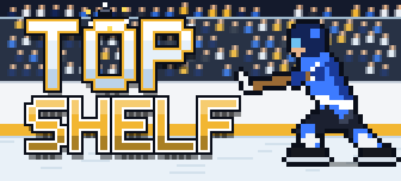

# Top Shelf

<p align="center"></p>

3-on-3 pixel-art arcade hockey for the browser: Canvas 2D rendering, synthesized Web Audio, keyboard/mouse/touch and Xbox-controller support, and online play against a friend (browser to browser over WebRTC via [Trystero](https://github.com/dmotz/trystero), no game server). The in-game **?** tab explains the mechanics.

> **This project is vibe coded.** It was built almost entirely by an AI coding assistant, prompted by a person, as an
> experiment. Treat it as a playground, not as production software: the code has not been carefully reviewed,
> design decisions were made quickly, and things may break or change at any time. Don't rely on it, and read the
> code critically before reusing any of it.

## Commands

```bash
npm install
npm run dev        # dev server with hot reload (http://localhost:5173)
npm run build      # static build into dist/ (deployable anywhere)
npm run preview    # serve the production build
npm test           # unit tests (Vitest)
npm run typecheck  # TypeScript check
npm run format     # Prettier
```

## Layout

```
index.html            markup: HUD, stage, touch pad, menus
src/
  main.js             bootstrap: wires listeners, applies saved prefs, starts the loop
  bindings.js         connects the simulation's events to render/, audio/ and ui/
  config.ts           world size, rink/net geometry, physics constants
  settings.ts         user options (difficulty, jerseys, arena, toggles)
  core/               loop, event bus, math helpers, clock, DOM helper, localStorage
  data/               pure tables: teams/colors, pucks, stadiums, difficulty, roster names, online emotes
  game/               simulation (never imports render/, audio/ or ui/; runs headless)
    fx.js             the simulation's outlet: sounds, effects, camera, HUD and screen changes as events
    world.js          G (game state), puck, referee, particles, replay buffer
    players.js        player factory + roster generation
    kit.js            active team colors/palettes and puck style
    physics/          rink & net collisions, steering, integration
    ai/               team tactics, goalies, referee
    states/           faceoff, celebrate, brawl, zamboni
    match.js          start/end game, goals, periods, pause
    practice.js       training modes
    online.js         online play, the simulation's side: team 1's human seat, who is steered by whom
    update.js         per-tick state dispatch
  net/                online play (loaded only when you host or join): Trystero rooms and their privacy
                      rules (session.js), the host's frames and the guest's playback (match.js),
                      snapshots (snap.js), message checks and the mirror between the two views (proto.js)
  render/             canvas drawing: sprites, ice, stands, players, puck, effects, mode-7 replay cam
  audio/              Web Audio engine, procedural skate sounds, synth voices, SFX table, goal songs
  input/              shared input state + keyboard, mouse, touch, game controller, haptics
  ui/                 DOM UI: HUD, menu, customization, player card, touch pad, online emotes and fight vote,
                      the home-screen tip on phones (install.js)
  styles/             CSS split by area
tests/                Vitest specs
```

## Conventions

- **Shared mutable state lives in objects**, because ES module imports are read-only:
  `G` (match state), `settings`, `view` (canvas context, size, zoom), `kit`, `clock`, `mixer`, `touchState`.
  To change one from another module, assign the property (`settings.periodLen = 60`).
- **The simulation talks to the presentation through events.** `game/` announces what happened via `game/fx.js`
  (`S('steal')`, `banner(...)`, `zoom(2)`, `screen('over', …)`), which emits on the bus in `core/events.ts`;
  `bindings.js` subscribes the real sound, drawing and DOM functions. Emits are synchronous, so they behave like
  direct calls. With nothing subscribed the game still runs: `tests/headless.test.ts` plays a whole match in Node.
- **Modules only declare things at load time.** Event listeners are registered in `init*()` functions that `main.js` calls in order.
- **TypeScript is adopted gradually.** `allowJs` is on, so convert a module by renaming it to `.ts` and adding types. Start with leaf modules (`data/`, `game/physics/`), then work up.

## Next refactoring steps

1. ~~Decouple simulation from presentation~~ (done: `game/` emits events through `game/fx.js`, see Conventions).
2. Pass `ctx` explicitly to draw functions instead of swapping `view.ctx` (done today in `ui/preview.js` and `render/mode7.js`).
3. Use a seeded RNG so replays and AI tests are deterministic.
